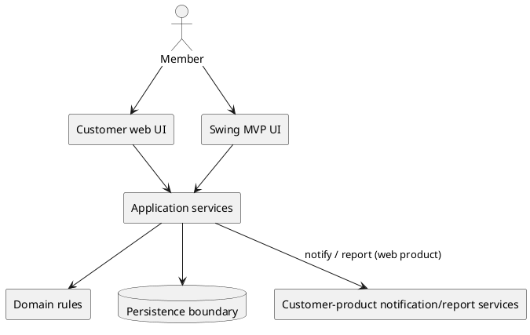
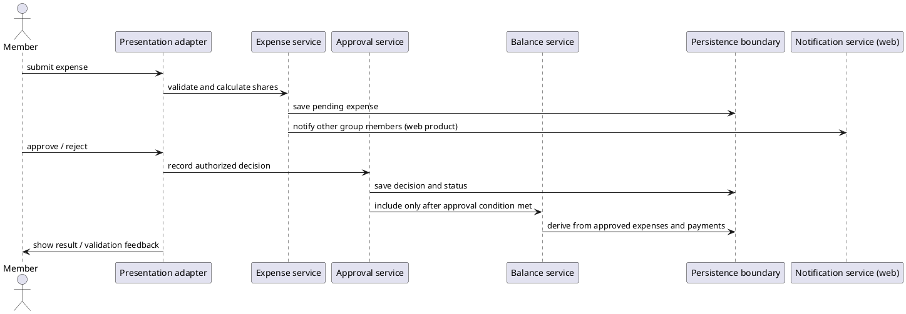

# SplitSmart — Architecture and Design

**Artifact:** Independent GitHub Copilot architecture/design
**Status:** Design proposal; stakeholder decisions remain open
**Authoritative inputs:** `.specify/memory/constitution.md` and `specs/001-expense-sharing/spec.md`

## 1. Goal and boundaries

SplitSmart has two distinct deliverables: a customer product that is primarily
web-based and a Java Swing desktop MVP prototype. The Swing MVP is not the
customer product and cannot satisfy the web-platform requirement on its own
(NFR-001). Both deliverables must preserve the specified account, group,
expense, approval, and monetary semantics; the product also includes
notifications and reports, while the Swing MVP explicitly excludes those and
uses one approval level (FR-005, FR-006, FR-009 and the Java Swing MVP Scope).

This is a logical design, not an implementation or deployment plan. It does
not select a web framework, transport, database, hosting model, currency set,
or notification channel: the source documents do not specify them. Java 21,
Maven, Swing, JUnit 5, and PlantUML are constitution constraints for the Java
application and its quality process, not authority to replace the web product.
The design keeps product capabilities and the Swing prototype scope visibly
separate.

## 2. Architecture

Use the same conceptual responsibility boundaries in both deliverables:

1. **Presentation adapters** — a web user interface for the customer product
   and a Swing user interface for the separate prototype. They collect input,
   show authorized results and validation feedback, and delegate all business
   operations. Swing handlers contain no expense, approval, or balance rules.
2. **Application services** — operations for account access, group
   membership, expense submission/review, balance queries, payment recording,
   notifications, and reports. They coordinate authorization, domain
   validation, state changes, and result/error reporting.
3. **Domain rules** — account/group membership and permissions, expense
   splitting, approval state, and balance/payment calculations. This boundary
   is independent of either UI. Java business logic has no Swing dependency.
4. **Persistence and external-service boundaries** — abstract ports for
   durable application records and, for the web product, the email recovery
   and notification delivery needed by the requirements. Concrete technologies
   and deployment are deliberately undecided.

The Swing adapter may call application operations directly within the
prototype; the web adapter uses an application boundary whose transport is
undecided. This is a logical separation, not a claim that the two products
share a runtime or codebase. Whether a common service implementation is
feasible depends on the eventual web stack and is an open implementation
decision.

### Main components and responsibilities

| Component | Responsibility | Trace |
|---|---|---|
| Web presentation | Account, group, expense, approval, balance, payment, and report interactions for the customer product | NFR-001; FR-001–FR-009 |
| Swing presentation | Prototype interactions for the explicitly included MVP subset; delegates operations | Constitution II, IV; Java Swing MVP Scope |
| Access and membership service | Account access/recovery flow; manager-controlled invitations/additions/removals; access checks for each group operation | FR-001, FR-002; NFR-002 |
| Expense service | Validate and record expenses, participant order, split method, optional receipt reference/content, payer and approval status | FR-003, FR-004 |
| Approval service | Apply configured approval levels in the customer product; one review level in the MVP; prevent unapproved expenses affecting balances | FR-005; SC-003 |
| Balance/payment service | Calculate expense obligations and apply recorded settlements; provide group-scoped pairwise balances and history | FR-007, FR-008; NFR-003; SC-003 |
| Notification service | Notify every other group member when a new expense is created in the customer product | FR-006; SC-005 |
| Reporting service | Return expense, balance, and payment summaries filtered by selected date range/parameters in the customer product | FR-009; NFR-005; SC-004 |
| Persistence boundary | Store/retrieve authorized records without prescribing a storage product | NFR-002, NFR-003 |

### Interfaces and data flow

Presentation adapters submit requests to application operations with the
current account context and requested group/entity. Application operations
authorize the context, validate input, invoke domain rules, persist successful
changes, then return a result or a structured rejection. Group reads and
mutations use the same authorization boundary. Expense approval commits its
decision and makes the expense balance-eligible only when the configured
approval condition is satisfied. Balance reads derive results only from
approved expenses and recorded payments. Customer-product expense creation
also triggers notifications to the other group members; report requests read
authorized records and apply selected filters.

The exact web transport, persistence technology, transaction mechanism,
receipt storage, and email/notification providers are not specified and must
be chosen later. A persistence implementation must ensure a failed validation
or denied operation does not partially change protected data (NFR-002).

## 3. Data model

These are logical records, not a physical schema. Group-scoped records are
always evaluated in their group context.

| Record | Key information and relations |
|---|---|
| **User account** | Identity, email, sign-in credentials; owns personal account access and may have memberships |
| **Group** | Group identity, manager(s), members, and configured approval policy |
| **Membership** | User, group, role/permissions, and active/removed status; removal ends the former member's group access while current members/managers retain history |
| **Expense** | Group, submitter, payer (a group member), amount and currency, date, description, split method, optional receipt, status, and recorded participant order |
| **Expense share** | Expense, participant, entered percentage when applicable, and final exact amount in the currency's minor-unit scale |
| **Approval** | Expense, authorized approver, decision, and decision time; multiple decisions/levels may be needed for the customer product |
| **Payment** | Group, payer/sender, recipient, amount and currency, and date; records settlement and does not transfer money |
| **Balance view** | Derived group-scoped net amount owed between member pairs from approved expense shares and payments; not an independent source of truth |
| **Notification** | Customer-product notice identifying a newly created expense and its recipient |
| **Report result** | Derived expense, balance, and payment summaries for the requested date range and parameters |

Store monetary values and perform monetary calculations as `BigDecimal`, with
an explicit currency and minor-unit scale at the relevant business boundary.
Do not use binary floating-point for money. The supported currencies and their
scales remain undecided; no single currency or scale is assumed (Constitution
V; NFR-003).

## 4. Core behavior and workflows

### Expense submission, review, and balance inclusion

1. A signed-in member selects an active group, a group-member payer, one or
   more participants in a recorded order, amount/currency, date, description,
   split method, and optionally a receipt.
2. The expense service verifies group membership, payer eligibility, positive
   representable amount, participants, and split inputs. Invalid input is
   rejected before a pending expense is created.
3. Calculate shares exactly using `BigDecimal`. For equal splits, divide the
   amount into minor units and distribute any remainder deterministically by
   recorded participant order. For percentage splits, require an exact 100%
   total; calculate exact proportional shares, assign whole minor units, then
   distribute remaining units by descending fractional remainder, breaking
   ties by recorded participant order. In both cases final shares sum exactly
   to the expense and contain no sub-minor-unit balances (FR-004, edge cases,
   NFR-003).
4. Record the expense as pending. An authorized approval decision is recorded
   against it. A rejection leaves it out of balances; approval makes it
   balance-eligible only after all configured levels approve. The Swing MVP
   has one level; the customer product must support configured single or
   multiple levels (FR-005).
5. For an approved expense, credit the payer for the full paid amount and
   charge each selected participant their final share. If the payer is a
   participant, their own share offsets their credit; if not, only the
   participants owe their shares. Aggregate these obligations by group and
   member pair, then apply recorded payments to the corresponding pairwise
   net balance (FR-003, FR-007, FR-008).
6. On customer-product expense creation, notify every other group member
   (FR-006). The delivery channel and retry behavior need stakeholder/design
   decisions. The Swing MVP does not implement this notification capability.

### Accounts, membership, payments, and reports

- Account creation, email/password sign-in, and email-based recovery are
  exposed as account operations (FR-001). Recovery implementation details
  are not prescribed.
- A group manager creates a group and invites/adds or removes members. Each
  group request checks active membership and relevant manager/approval
  permissions. Removed users lose group-detail access; current members and
  managers retain history (FR-002, NFR-002).
- A payment records an actual settlement between two users; it is not a money
  transfer. It is included in payment history and reduces the applicable
  pairwise balance by its recorded amount (FR-008). Who may record payments,
  partial-payment rules, and overpayment behavior remain open.
- Customer-product reports apply the selected date range and parameters to
  expenses, balances, and payments. No matches produce an empty result with
  a clear explanation, not a fabricated total (FR-009). Reports are outside
  the Swing MVP.

## 5. Validation, errors, and access control

Reject zero, negative, or currency-unrepresentable expense amounts; percentage
totals other than exactly 100%; missing/ineligible group payer or participants;
and unauthorized group operations. Invalid expense data must not create a
pending record. Pending and rejected expenses never affect balances. Return
clear, field-appropriate validation errors; for access denials, do not reveal
protected group details and leave protected data unchanged (FR-003–FR-005,
NFR-002, edge cases).

Application operations should distinguish validation failures, denied access,
missing/inaccessible records, and unavailable persistence or delivery
boundaries so the adapter can present an appropriate outcome. The sources do
not specify error codes, retry policies, or availability targets; those are
not fixed here. Do not include passwords or recovery secrets in user-facing
errors or routine diagnostics; exact credential and receipt protections
require implementation design and review.

Authorization is enforced at the application boundary for both reads and
writes, not solely by hiding UI controls. Expense approvers must have explicit
approval permission. The precise approval eligibility rules (including
self-approval) are unresolved in the spec.

## 6. Quality attributes

- **Privacy/access:** Personal information is limited to the account holder;
  group data is limited to active members with applicable permissions.
  Removal immediately ends former-member access while retaining group history
  for current members/managers (NFR-002).
- **Monetary integrity:** Exact `BigDecimal` calculations, explicit scale,
  minor-unit rounding/allocation, and reconciliation checks preserve totals.
  Pending/rejected expenses do not enter balance calculations (Constitution
  V; NFR-003; SC-002, SC-003).
- **Web product scope:** The customer product remains primarily web-based.
  Swing is a separate desktop prototype and must not be presented as
  customer-compliant (NFR-001).
- **Responsiveness:** Measure report requests against the agreed representative
  workload; target at least 95% within five seconds for up to 1,000 group
  expenses. This is proposed and awaits stakeholder confirmation; do not
  assume a specific indexing, caching, or infrastructure solution (NFR-005,
  SC-004).
- **Usability:** Validate the account-to-expense-to-balance task with
  first-time users against the 90% success target. Neither source defines
  specific accessibility criteria; accessibility requirements and evaluation
  need stakeholder confirmation rather than an invented compliance claim
  (NFR-004; SC-001).

## 7. Verification and testability

Keep domain and application behavior callable without constructing Swing
components. Use JUnit 5 for Java tests, with business-rule tests requiring no
graphical display (Constitution IV, VI). Test at least:

- Account creation/sign-in/recovery and personal-information boundaries;
  manager/member permissions, outsider denial, and former-member access
  revocation (FR-001, FR-002; NFR-002).
- Positive amount and currency-scale validation; equal and percentage
  allocations, exact-100% rejection, largest-remainder tie ordering, and
  allocation totals; payer inside/outside participant cases (FR-003, FR-004;
  NFR-003; SC-002).
- Pending/rejected exclusion, approval eligibility and configured completion,
  and approved-expense/payment pairwise balances, including payment history
  (FR-005, FR-007, FR-008; SC-003).
- Customer-product notification delivery for every other member and
  date-filtered report inclusion/exclusion, empty results, and the proposed
  response-time dataset (FR-006, FR-009; SC-004, SC-005).
- UI-boundary/integration checks for user-visible workflows; usability tests
  for the stated first-time-user target. Customer readiness requires passing
  acceptance tests for FR-001 through FR-009 (Constitution VI, VIII; SC-001,
  SC-006).

Maintain architecture and key workflow diagrams as PlantUML source and update
them when component boundaries or workflows materially change (Constitution
VII). The following concise source illustrates the logical, dual-presentation
boundary and approval-to-balance flow; it does not prescribe deployment:

## 8. Decisions, trade-offs, assumptions, and open questions

### Decisions and trade-offs

1. **Separate web product and Swing MVP.** Both are retained because the
   clarified spec requires them; a Swing-only design would contradict NFR-001.
   The cost is two presentation targets and potentially distinct deployment
   arrangements. Their concrete relationship is not selected.
2. **Layered logical boundaries, not a mandated service topology.** Keeping
   UI, application operations, domain rules, and persistence responsibilities
   distinct satisfies testability and Swing separation without assuming a
   database, network protocol, or unnecessary microservices (Constitution
   II–IV).
3. **Persist source records and derive balances.** Approved expense shares
   and recorded payments are the source facts; balances are derived. This
   avoids treating pending/rejected expenses as financial state and allows
   reconciliation (FR-005, FR-007, FR-008; SC-003).
4. **Explicit exact-money allocation.** Use `BigDecimal`, currency scale, and
   the specified deterministic remainder rule, accepting that the supported
   currency set and policy boundary must be decided before implementation
   (Constitution V; FR-004; NFR-003).
5. **Do not assume payment or approval policy details.** The product supports
   the stated operations but leaves eligibility, partial/overpayment behavior,
   and approval policy specifics unresolved rather than inventing rules.

### Assumptions

- Each person has one account; sign-in uses email and password and recovery
  uses email, as stated in the spec assumptions.
- Managers may invite/add/remove members; the spec assumes at least one
  manager per group.
- Expense payer is a group member and may be outside the participants; the
  payer receives full credit and participant shares are charged as specified.
- A payment records a settlement and does not itself transfer money.
- Notifications and reports are product capabilities, not Swing MVP
  capabilities; multiple approval levels are product scope, while the MVP
  uses one.
- Record participant order as part of the expense so rounding ties are
  reproducible.

### Open questions and conflicts

- **Platform/implementation tension:** Constitution Principles I–II mandate
  Java 21/Maven and Swing for the Java application, while NFR-001 requires a
  primarily web-based customer product. The clarified specification resolves
  the product scope as both a web product and separate Swing prototype, but
  does not specify the web stack or approve representing Swing as compliant.
  Stakeholder confirmation and a web implementation decision remain
  necessary.
- **Unresolved specification questions:** approval eligibility/self-approval
  and edit/rejection behavior; supported currencies/scales; multi-factor
  authentication; notification channel; report filters/export; payment
  eligibility, partial payments and overpayments; account-history lifecycle;
  and target workload (spec Open Questions 1–7).
- **Balance semantics:** The spec calls for pairwise net amounts owed but does
  not explicitly state whether obligations are maintained per expense/payer
  or further netted across a group. This design attributes each participant's
  share to that expense's payer and aggregates by pair; confirm that this is
  the intended meaning before implementation, especially where multiple
  payers and reverse obligations exist.
- **Persistence, transport, deployment, receipt handling, credential
  protection details, and operational error/retry behavior** are unspecified;
  select them only after product and stakeholder constraints are known.
- **Accessibility:** no explicit accessibility requirement is in the source;
  obtain criteria before claiming conformance.

## 9. Traceability and self-review

| Source requirement/principle | Design coverage |
|---|---|
| **FR-001** | Account/access service; account workflow; access-boundary tests |
| **FR-002** | Group/membership records and manager operations; removal and outsider denial |
| **FR-003** | Expense record, payer/participant semantics, optional receipt, amount validation and payer credit |
| **FR-004** | Equal/percentage calculations, exact 100%, deterministic minor-unit remainder |
| **FR-005** | Approval service and pending/rejected exclusion; one-level MVP vs configurable product levels |
| **FR-006** | Customer-product notification service and per-member delivery tests; excluded from MVP |
| **FR-007** | Derived pairwise balances from approved expense shares and payments |
| **FR-008** | Settlement record, balance effect, history; unspecified eligibility/partial/overpayment remain open |
| **FR-009** | Customer-product filtered reports, empty result behavior, performance test; excluded from MVP |
| **NFR-001** | Separate web customer product and Swing prototype; no claim that Swing fulfills web |
| **NFR-002** | Application-boundary access checks, group removal behavior, no-change denial behavior |
| **NFR-003** | `BigDecimal`, explicit currency scale, exact reconciliation |
| **NFR-004** | First-time-user usability target and test |
| **NFR-005** | Proposed report workload/latency target and measurement, pending confirmation |
| **SC-001–SC-006** | Included in verification plan; notification/report checks apply to complete product scope |
| **Constitution I–II** | Java 21/Maven and Swing constrained to Java application/MVP; web conflict called out |
| **Constitution III–IV** | Cohesive responsibility boundaries; UI delegates; domain callable without Swing |
| **Constitution V–VI** | Exact monetary handling; JUnit 5 and required business/workflow tests |
| **Constitution VII** | PlantUML component and workflow source included and update policy stated |
| **Constitution VIII** | Traceability matrix and human review explicitly required before acceptance |

**Self-review:** All nine FRs, five NFRs, six SCs, and eight Constitution
principles are addressed above without inventing requirement IDs. The main
material conflict is the Java/Swing implementation constraint versus the
primarily web customer product; the spec correctly requires both a web
product and separate Swing prototype, but web technologies remain undecided.
The Swing MVP's excluded notifications/reports and reduced approval levels
are distinguished from complete customer scope. Currency scale, approval and
settlement policy, pairwise netting semantics, workload confirmation, and
several infrastructure details remain unresolved rather than being asserted
as settled design facts. This document proposes no implementation or claims
that any acceptance test has passed. Human review remains required by
Constitution VIII.
